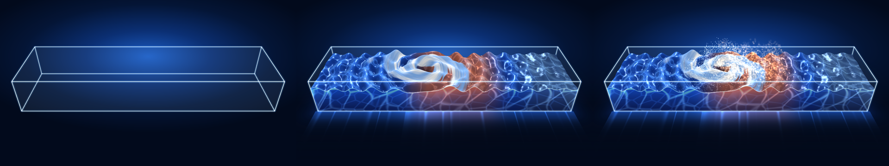

# oceantank

Build a **rectangular glass tank**, **fill it with ocean water**, and render it in Python exactly as the
HTML/three.js animation *"Cyclone: from birth to collapse"* does. No browser, no display and no GPU required.



How it works: the animation's **GLSL shaders are reused verbatim** (extracted from the HTML by
`tools/extract_shaders.js`). Geometry, camera matrices, draw order and blending follow three.js r128, and rendering is
done with headless OpenGL ([moderngl](https://github.com/moderngl/moderngl) + EGL/Mesa).

## Quick start

Requirements: Python >= 3.10 and an OpenGL 3.3 driver (already present on a desktop PC; on a headless server:
`sudo apt install libegl1 libgl1 libgles2 libgl1-mesa-dri`, Mesa then renders in software).

```bash
python3 -m venv venv && source venv/bin/activate         # Windows: venv\Scripts\activate
pip install git+https://github.com/TON_USERNAME/oceantank.git    # or, from a clone: pip install -e .

oceantank still tank.png          # one image
oceantank gif cycle.gif           # one full 32 s cycle: formation -> warm zone -> collapse
```

In Python:

```python
from oceantank import Tank, Scene, Timeline, Camera, over
from PIL import Image

tank = Tank(length=30, width=8, depth=3.2, glass_height=4.3)
tl = Timeline(tank, start_ready=False)
tl.run_to(14)                                  # time 14 s in the 32 s cycle

scene = Scene(tank).build_glass()              # 1) the glass tank (12 glowing edges + panes)
scene.add_ocean()                              # 2) the ocean water: surface, flanks, floor, ground reflections
scene.add_particles(tl)                        # 3) optional: spray, bubbles, steam, surface tracers

Image.fromarray(over(scene.render(tl, Camera(az=0.4, el=0.62), (1280, 720)))).save("tank.png")
```

Notebook-friendly shortcut:

```python
from oceantank import Viewer
v = Viewer(size=(960, 540))
v.frame(at=14, az=0.4)        # PIL image, displayed automatically in Jupyter/Colab
v.gif("cycle.gif")            # one full cycle
```

If rendering fails with `cannot open display` or `GLSL Compiler failed`, force Mesa software rendering:
`LIBGL_ALWAYS_SOFTWARE=1 oceantank still tank.png`.

## The cycle

The cyclone crosses the tank in **32 s** (x from -11.2 to +11.2): it forms on the left, intensifies over the warm zone
(x from -3 to 5.5), then weakens and collapses in cold water.


| Command | What it does |
|---|---|
| `oceantank still out.png --at 8` | one image at t = 8 s (prints the cyclone position) |
| `oceantank gif out.gif --fps 8 --speed 2` | a full cycle, twice as fast |
| `oceantank gif out.gif --start 10 --duration 12` | only part of the cycle |
| `oceantank frames frames/ --size 1920x1080` | PNG sequence (then `ffmpeg -framerate 12 -i frames/f%04d.png -pix_fmt yuv420p out.mp4`) |
| `--az 0.5 --el 0.4` | camera angle (radians) |

## Jupyter / Google Colab

[`examples/oceantank_colab.ipynb`](examples/oceantank_colab.ipynb): install, single image, step-by-step build, sliders (time and
camera angle) and a full-cycle GIF. In Colab, run the first cell: it installs the OpenGL libraries and the package
(upload the wheel, or it installs from this repository). No GPU needed (`LIBGL_ALWAYS_SOFTWARE=1`).
Verified: complete notebook execution with nbconvert on headless Linux. **Not verified**: Colab itself and the
interactive sliders (they need a browser front end).

## How close is it to the HTML animation? (measured)

`tools/compare_with_html.py` renders the same frame in Chromium (three.js r128, SwiftShader) and in Python, with the
same random seeds (Mulberry32 injected into the page), the same state, camera and resolution (960x540).


| Case | Mean abs. error (of 255) | PSNR |
|---|---|---|
| **Glass + water**, hash shared by both renderers | **0.37** | **41 dB** |
| + a single particle layer (spray, steam, heads, segments) | 0.48 - 0.91 | 34 - 38 dB |
| Full scene, shared hash | 1.3 - 1.6 | 30 - 32 dB |
| Full scene, **original shader** (`hash_mode="native"`) | 6.4 | 24 dB |

- **Residual for glass + water**: 99.8 % of the pixels that differ by more than 16 levels lie on sharp edges (MSAA sample
  patterns differ between SwiftShader and llvmpipe). Geometry, camera, draw order, blending and lighting agree.
- **Why it is not exactly zero with the original shader**: the noise and caustics rely on `fract(sin(x) * 43758.5453)` with
  arguments around 10^4. Measured on that function alone, llvmpipe equals numpy float32 (zero error) while SwiftShader
  disagrees on 94 % of the values. The **fine caustics pattern therefore depends on the GPU/driver**, even between two
  browsers; this is not specific to this port. `hash_mode="native"` (default) gives the exact-`sin()` pattern;
  `hash_mode="portable"` swaps in a `sin`-free hash that is identical on every GPU but differs from the pattern your
  browser shows. Pixel-for-pixel equality with a given browser is therefore only expected on the same GPU and driver.
- **Particles**: each layer agrees at 34 - 41 dB (same seeds, positions and draw order); 1 px points and line
  segments are rasterised slightly differently by the two engines.

## Limitations

- No frustum culling (three.js may skip an off-screen flank for some camera angles).
- The HUD, labels and CSS background are not part of the WebGL canvas; `over()` reproduces the page's radial-gradient background.
- `Timeline` uses the animation's simplified intensity model; to drive it from another source (for example a physical
  solver) pass `itab=` (a table of 1601 values).
- Software rendering (llvmpipe) takes about 2 s per 960x540 frame; a GPU with EGL is used automatically when available.
- Tested on Linux (Ubuntu, Mesa; Python 3.13 and 3.14). Windows and macOS are untested (moderngl supports them in principle).
- The original HTML animation (French UI) is not included in this repository; the comparison tool needs a path to it.

## Development

```bash
pip install -e ".[test]"
pytest                                   # 14 tests, a few seconds
OCEANTANK_HTML=/path/index.html OCEANTANK_THREE=/path/three.min.js pytest   # + browser comparison (needs playwright)
node tools/extract_shaders.js /path/index.html src/oceantank/shaders         # re-extract the shaders
python tools/make_notebook.py                                                # regenerate the notebook (needs nbformat)
```

Project layout: `src/oceantank/` (`spec` tank dimensions, `geometry`, `camera`, `timeline` cyclone state and particles,
`scene` layers and draw order, `render_gl` OpenGL renderer, `shaders` GLSL loading, `compose` background, `api` notebook
`Viewer`, `cli`), `tests/`, `tools/`, `examples/`, `docs/`.

## License

MIT, see [LICENSE](LICENSE).
