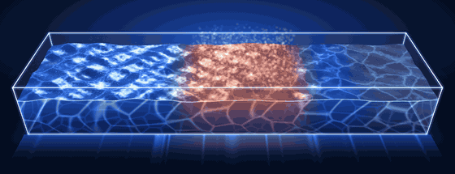
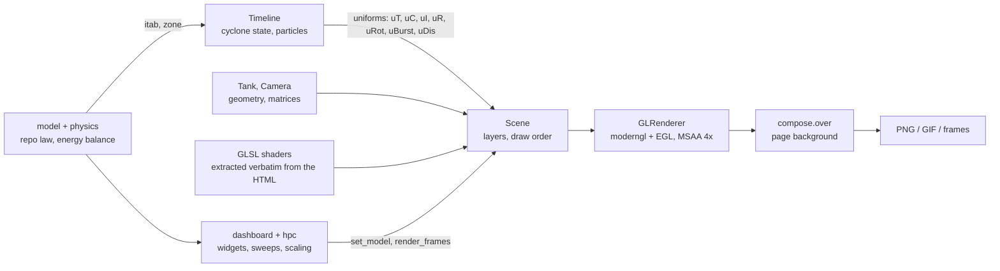
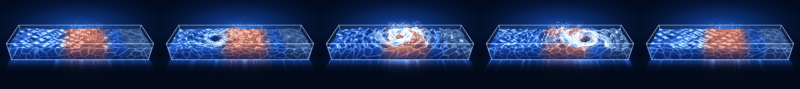
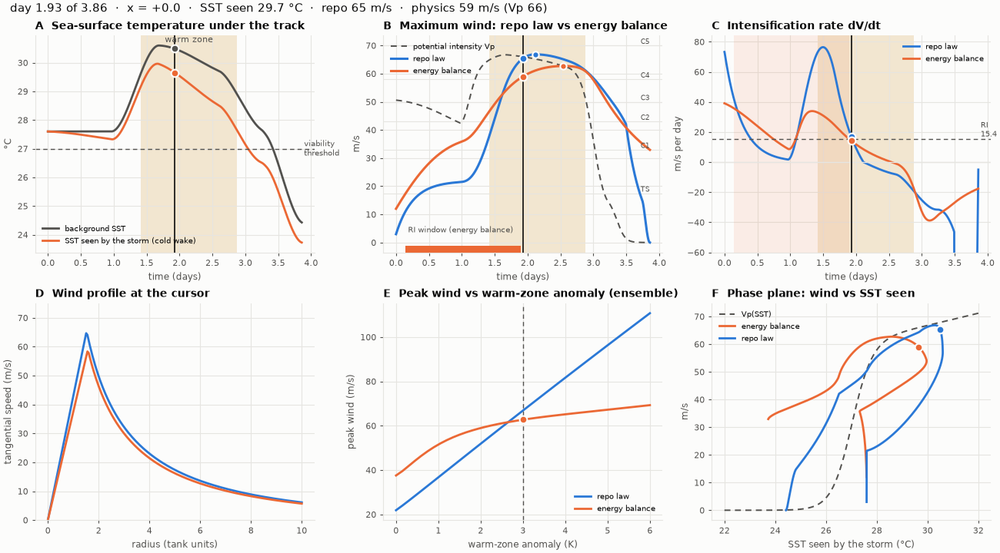
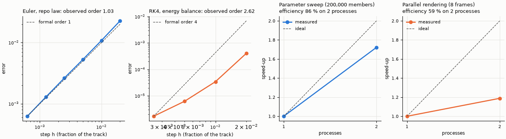
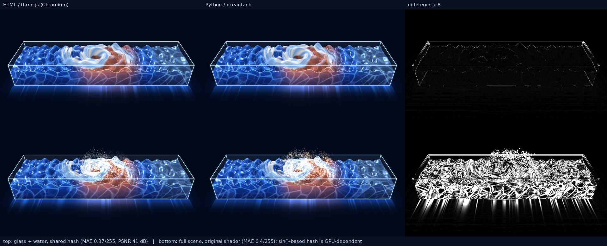

# oceantank

[](https://github.com/CodingYayaToure/oceantank/actions/workflows/ci.yml)


[](https://colab.research.google.com/github/CodingYayaToure/oceantank/blob/main/examples/oceantank_colab.ipynb)
[](https://colab.research.google.com/github/CodingYayaToure/oceantank/blob/main/examples/oceantank_dashboard.ipynb)

**A rectangular glass tank, filled with ocean water, crossed by a tropical cyclone, rendered in pure Python.**
Deterministic, headless (no browser, no display, no GPU required) and cross-validated against the original three.js animation.

<p align="center">
  
  <br><em>One full 32 s cycle: formation, rapid intensification over the warm zone (orange), weakening over cold water.</em>
</p>

## Contents

[Overview](#overview) · [Quick start](#quick-start) · [The cycle](#the-cycle) · [Models](#mathematical-and-physical-models) · [Dashboard and HPC](#dashboard-and-hpc-tools) · [Validation](#validation-against-the-html-animation) · [Notebook](#jupyter--google-colab) · [Limitations](#limitations) · [Development](#development) · [References](#references)

## Overview

`oceantank` reproduces, frame for frame, the WebGL animation *"Cyclone: from birth to collapse"*:

- the **GLSL shaders are reused verbatim** (extracted from the HTML by `tools/extract_shaders.js`);
- geometry, camera matrices, draw order and blending follow **three.js r128**;
- rendering uses headless OpenGL ([moderngl](https://github.com/moderngl/moderngl) + EGL / Mesa);
- all random numbers come from **Mulberry32**, the same stream as in the browser, so a frame is reproducible bit for bit on a given GPU/driver.


| Layer | What it is | Nature |
|---|---|---|
| Camera, rasterisation, blending | perspective projection, 4× MSAA, ordered transparency | exact three.js conventions |
| Water surface | analytic height field: ambient sea, eye depression, spiral bands, radiating rings with wall reflections, wake | hand-built, analytic |
| Cyclone intensity | sea-surface-temperature profile → intensity by relaxation along the track | phenomenological, tuned |
| Surface tracers | modified Rankine vortex with inflow | analytic |
| Energy-balance model (optional) | Emanuel-type intensity with sea-surface cooling, RK4, compared with the law above | reduced physical, calibrated |

> **What this is not.** `oceantank` is a model-scale *visualisation*, not a numerical weather prediction code: it does not integrate
> the primitive equations, and its units are tank units, not metres. The animation's law is phenomenological; the optional energy-balance model is
> *reduced and calibrated, not measured*. Both are documented, with their status, in [`docs/MODELS.md`](docs/MODELS.md).

### Architecture



## Quick start

Requirements: Python >= 3.10 and an OpenGL 3.3 driver (already present on a desktop PC; on a headless server:
`sudo apt install libegl1 libegl-mesa0 libgl1 libgles2 libgl1-mesa-dri`, Mesa then renders in software).

```bash
python3 -m venv venv && source venv/bin/activate         # Windows: venv\Scripts\activate
pip install git+https://github.com/CodingYayaToure/oceantank.git    # or, from a clone: pip install -e .

oceantank still tank.png          # one image
oceantank gif cycle.gif           # one full 32 s cycle: formation -> warm zone -> collapse
```

In Python:

```python
from oceantank import Tank, Scene, Timeline, Camera, over
from PIL import Image

tank = Tank(length=30, width=8, depth=3.2, glass_height=4.3)
tl = Timeline(tank, start_ready=False)
tl.run_to(14)                                  # time 14 s in the 32 s cycle

scene = Scene(tank).build_glass()              # 1) the glass tank (12 glowing edges + panes)
scene.add_ocean()                              # 2) the ocean water: surface, flanks, floor, ground reflections
scene.add_particles(tl)                        # 3) optional: spray, bubbles, steam, surface tracers

Image.fromarray(over(scene.render(tl, Camera(az=0.4, el=0.62), (1280, 720)))).save("tank.png")
```

Notebook-friendly shortcut:

```python
from oceantank import Viewer
v = Viewer(size=(960, 540))
v.frame(at=14, az=0.4)        # PIL image, displayed automatically in Jupyter/Colab
v.gif("cycle.gif")            # one full cycle
```

If rendering fails with `cannot open display` or `GLSL Compiler failed`, force Mesa software rendering:
`LIBGL_ALWAYS_SOFTWARE=1 oceantank still tank.png`.

## The cycle

The cyclone crosses the tank in **32 s** (x from -11.2 to +11.2, 0.7 tank units/s): it forms on the left, intensifies over the warm zone
(x from -3 to 5.5), then weakens and collapses in cold water.



| Command | What it does |
|---|---|
| `oceantank still out.png --at 8` | one image at t = 8 s (prints the cyclone position) |
| `oceantank gif out.gif --fps 8 --speed 2` | a full cycle, twice as fast |
| `oceantank gif out.gif --start 10 --duration 12` | only part of the cycle |
| `oceantank frames frames/ --size 1920x1080` | PNG sequence (then `ffmpeg -framerate 12 -i frames/f%04d.png -pix_fmt yuv420p out.mp4`) |
| `--az 0.5 --el 0.4` | camera angle (radians) |

## Mathematical and physical models

Everything below is what the code actually computes. Full derivations, parameter values and code locations are in
**[`docs/MODELS.md`](docs/MODELS.md)**.

**1. Sea-surface temperature (SST).** A smooth, imposed profile along the track: a warm patch on $[-3,\ 5.5]$ and cold water at the end,
built from cubic smoothsteps $\mathrm{ss}$ (peak 30.5 °C, minimum 24.4 °C).

**2. Intensity law.** The cyclone intensity $I$ relaxes along its track towards a target set by the SST, with the classical
26.5 °C genesis threshold (Gray, 1968):

```math
I^{\ast}(x)=\Bigl[\max\Bigl(0,\tfrac{\mathrm{SST}(x)-26.5}{4}\Bigr)\Bigr]^{0.9},\qquad
\frac{dI}{dx}=\frac{I^{\ast}-I}{\lambda},\quad
\lambda\in\lbrace 1.5\ \text{(growth)},\ 1.4\ \text{(cold decay)},\ 5.2\ \text{(warm decay)} \rbrace
```

integrated with explicit Euler on 1600 steps ($\Delta x/\lambda\le0.01$; refining 10× changes the table by at most $4.5\times10^{-3}$).
The *form* (relaxation towards an SST-controlled target) mirrors potential-intensity theory (Emanuel, 1986), but the target is tuned,
not a computed potential intensity.

**3. Water surface.** One analytic height field $H(x,z,t)$ displaces a 264 000-triangle mesh:

```math
H=h_\text{amb}\ (1+\ldots)+I\Bigl[-1.75\ e^{-(r/0.6R)^2}+0.26\ e^{-((r-1.1R)/0.5R)^2}+0.2\ e^{-(r/3.2R)^2}\Bigr]
+0.2\ I\sin\bigl(2(\theta+\phi)-5\ln\tfrac rR\bigr)+\text{rings}
```

(eye depression, eyewall ring, two-arm logarithmic spiral, radiating gravity-wave rings reflected on the tank walls by the **method of images**).
Normals come from finite differences of $H$; shading uses a Fresnel term $(1-\mathbf n\cdot\mathbf v)^3$, Blinn-Phong specular $(\mathbf n\cdot\mathbf h)^{150}$,
Worley (cellular) caustics and fractal-noise foam.

**4. Wind field and tracers.** 2600 surface tracers are advected by a modified Rankine vortex with frictional inflow ($\arctan0.22\approx12.4^\circ$):

Inner core ($r \lt R_0$, solid-body rotation):

```math
V(r)=V_{\max}\ I\ \frac{r}{R_0}
```

Outer region ($r\ge R_0$, decaying wind):

```math
V(r)=V_{\max}\ I\ \Bigl(\frac{R_0}{r}\Bigr)^{0.85}e^{-(r-R_0)/11}
```

**5. Camera and blending.** Standard perspective matrix, $C=\alpha_sC_s+(1-\alpha_s)C_d$ (normal) or $C=\alpha_sC_s+C_d$ (additive), 4× MSAA.

**Reduced physics and where this package stops.** [`docs/MODELS.md`](docs/MODELS.md#5-energy-balance-intensity-model-reduced-implemented-and-other-reference-models)
documents the implemented energy-balance model (Bolton saturation, enthalpy disequilibrium, potential intensity, cold-wake feedback, RK4) and states that gradient-wind balance and
axisymmetric shallow water are **not** solved here. `Timeline(itab=...)` is the hook to drive the water, spiral and tracers from any intensity solver.

## Dashboard and HPC tools

`oceantank.dashboard` is an interactive dashboard (Jupyter / Colab) where the 3-D animation and six scientific panels move together: SST under the track and the cold wake,
wind of the **repo law** versus the **energy balance**, intensification rate with the rapid-intensification threshold, radial wind profile, ensemble sensitivity to the warm-zone anomaly,
and the wind-SST phase plane. Sliders change the ocean, the two models and the scenario (cold basin, hot anomaly, fast or slow mover, long or short warm zone, no cooling feedback);
the storm enters the warm zone, intensifies, and leaves it, in every panel at once.

```python
from oceantank.dashboard import Dashboard
Dashboard().show()          # in a notebook; needs: pip install "oceantank[dashboard]"
```



HPC part (`oceantank.hpc`, results in [`docs/MODELS.md`](docs/MODELS.md#7-verification-ensembles-and-scaling)):

| Tool | What it does |
|---|---|
| `hpc.sweep`, `hpc.sweep_physics` | parameter sweeps over a grid: vectorised over members, chunks spread over processes; identical for any number of workers |
| `hpc.convergence`, `hpc.convergence_physics` | observed order of accuracy against a finer reference (Euler 1.03, RK4 2.6 on the coupled problem, 4 on the smooth one) |
| `hpc.scaling`, `hpc.render_scaling` | strong scaling: speed-up, efficiency, Amdahl serial fraction, vectorisation gain |
| `Viewer.render_frames(times, workers=N)`, `Viewer.gif(..., workers=N)` | parallel rendering, one single-threaded GL context per process; frames pixel-identical to serial |

Measured on 2 vCPU: sweep of 200 000 members 1.72× faster on 2 processes (86 % efficiency), vectorisation about 1 500× faster than a Python loop, parallel rendering 1.19×
(Mesa already uses both cores for one frame). These numbers come from `tools/benchmark.py`; they say nothing about larger machines.



Notebook: [`examples/oceantank_dashboard.ipynb`](examples/oceantank_dashboard.ipynb) (dashboard, verification, sweeps, scaling, parallel GIF).

## Validation against the HTML animation

`tools/compare_with_html.py` renders the same frame in Chromium (three.js r128, SwiftShader) and in Python, with the same random seeds (Mulberry32 injected into the page),
the same state, camera and resolution (960x540).



| Case | Mean abs. error (of 255) | PSNR |
|---|---|---|
| **Glass + water**, hash shared by both renderers | **0.37** | **41 dB** |
| + a single particle layer (spray, steam, heads, segments) | 0.48 - 0.91 | 34 - 38 dB |
| Full scene, shared hash | 1.3 - 1.6 | 30 - 32 dB |
| Full scene, **original shader** (`hash_mode="native"`) | 6.4 | 24 dB |

- **Residual for glass + water**: 99.8 % of the pixels that differ by more than 16 levels lie on sharp edges (MSAA sample
  patterns differ between SwiftShader and llvmpipe). Geometry, camera, draw order, blending and lighting agree.
- **Why it is not exactly zero with the original shader**: the noise and caustics rely on `fract(sin(x) * 43758.5453)` with
  arguments around 10^4. Measured on that function alone, llvmpipe equals numpy float32 (zero error) while SwiftShader
  disagrees on 94 % of the values. The **fine caustics pattern therefore depends on the GPU/driver**, even between two
  browsers; this is not specific to this port. `hash_mode="native"` (default) gives the exact-`sin()` pattern;
  `hash_mode="portable"` swaps in a `sin`-free hash that is identical on every GPU but differs from the pattern your
  browser shows. Pixel-for-pixel equality with a given browser is therefore only expected on the same GPU and driver.
- **Particles**: each layer agrees at 34 - 41 dB (same seeds, positions and draw order); 1 px points and line
  segments are rasterised slightly differently by the two engines.

**Performance** (software rendering, 2 CPU cores, Mesa llvmpipe): about 0.5 s per frame at 800x450 and 0.8 s at 1280x720.
A GPU with EGL is used automatically when available.

## Jupyter / Google Colab

[`examples/oceantank_colab.ipynb`](examples/oceantank_colab.ipynb): install, single image, step-by-step build, sliders (time and
camera angle) and a full-cycle GIF. In Colab, click the *Open in Colab* badge above and run the cells from top to bottom: the first cell installs the OpenGL libraries and the package from this repository (no file upload, about 1 minute). No GPU needed (`LIBGL_ALWAYS_SOFTWARE=1`).
Verified: complete notebook execution with nbconvert on headless Linux. **Not verified**: Colab itself and the
interactive sliders (they need a browser front end).

[`examples/oceantank_dashboard.ipynb`](examples/oceantank_dashboard.ipynb) is the dashboard and HPC notebook (same install cell, *Dashboard in Colab* badge above). Verified by
nbconvert execution; the widgets themselves (drag, play) are **not** verified here, they need a browser.

## Limitations

- **Visualisation, not prediction**: the cyclone follows a tuned SST-to-intensity law, not the equations of motion (see [`docs/MODELS.md`](docs/MODELS.md)). Lengths are in tank units.
- No frustum culling (three.js may skip an off-screen flank for some camera angles).
- The HUD, labels and CSS background are not part of the WebGL canvas; `over()` reproduces the page's radial-gradient background.
- `Timeline` uses the animation's simplified intensity model by default; to drive it from another source pass `itab=` (a table of 1601 values), e.g. `physics.intensity_table()`.
- The energy-balance model is reduced (no vertical structure, convection, shear or dry air) and calibrated, not measured: no operational or forecast claim.
- Tested on Linux (Ubuntu, Mesa; Python 3.13 and 3.14; CI on 3.10, 3.12, 3.13). Windows and macOS are untested (moderngl supports them in principle).
- The original HTML animation (French UI) is not included in this repository; the comparison tool needs a path to it.

## Development

```bash
pip install -e ".[test,dashboard]"
pytest                                   # all tests (a few minutes with the parallel-rendering checks)
OCEANTANK_HTML=/path/index.html OCEANTANK_THREE=/path/three.min.js pytest   # + browser comparison (needs playwright)
node tools/extract_shaders.js /path/index.html src/oceantank/shaders         # re-extract the shaders
python tools/make_notebook.py                                                # regenerate the notebooks (needs nbformat)
python tools/make_dashboard_notebook.py
python tools/benchmark.py && python tools/make_figures.py                    # re-measure scaling, redraw the figures
```

Project layout: `src/oceantank/` (`spec` tank dimensions, `geometry`, `camera`, `timeline` cyclone state and particles,
`scene` layers and draw order, `render_gl` OpenGL renderer, `shaders` GLSL loading, `compose` background, `api` notebook
`Viewer`, `cli`; `model` vectorised SST-intensity law, `physics` energy-balance model, `hpc` sweeps / convergence / scaling, `dashboard` widgets and panels),
`tests/`, `tools/`, `examples/`, `docs/`.

## References

1. Gray, W. M. (1968). Global view of the origin of tropical disturbances and storms. *Mon. Wea. Rev.* **96**, 669-700.
2. Emanuel, K. A. (1986). An air-sea interaction theory for tropical cyclones. Part I. *J. Atmos. Sci.* **43**, 585-605.
3. Rotunno, R. & Emanuel, K. A. (1987). An air-sea interaction theory for tropical cyclones. Part II. *J. Atmos. Sci.* **44**, 542-561.
4. Bolton, D. (1980). The computation of equivalent potential temperature. *Mon. Wea. Rev.* **108**, 1046-1053.
5. Worley, S. (1996). A cellular texture basis function. *Proc. SIGGRAPH '96*, 291-294.
6. Schlick, C. (1994). An inexpensive BRDF model for physically-based rendering. *Computer Graphics Forum* **13**(3), 233-246.

## License

MIT, see [LICENSE](LICENSE).
